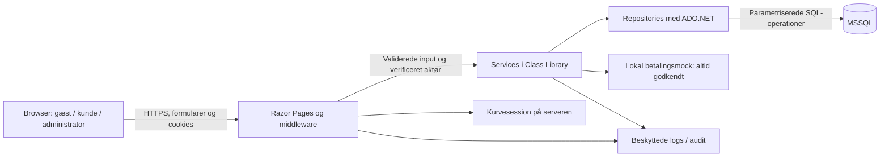

# 1.4 – Trusselsmodel for webshoppen

Dato: 21. oktober 2026. Metode: CIA/FIT og STRIDE fra tema 1–2, anvendt på den planlagte løsning inden for tema 1–5.

Modellen skelner mellem fund i den eksisterende kode og risici ved funktioner, der endnu ikke findes. Et planlagt forsvar er ikke et implementeret eller testet forsvar. Konkrete acceptkriterier findes i [acceptkriterier.md](acceptkriterier.md); scopebeslutninger i [afklaringer.md](afklaringer.md).

## Arkitektur og dataflow

Diagrammet er målarkitekturen. I den nuværende løsning ligger SessionCartService og kurvemodeller i webprojektet; produktservice/repository ligger i biblioteket. Login, ordrer, betalingsmock og sikkerhedsaudit er endnu ikke implementeret. Den eksisterende sessionlagerkonfiguration bruger hukommelse.

## Aktiver og sikkerhedsmål

| Aktiv | Fortrolighed | Integritet | Tilgængelighed |
|---|---|---|---|
| Brugeridentitet og passwordhash | Ingen passwords i klartekst eller logs; begrænset adgang til hashes. | Kun verificeret registrering/login/passwordændring; roller kan ikke vælges af kunden. | Begræns passwordforsøg uden at skabe unødvendig fælles spærring. |
| Autentifikationscookie og kurvesession | Ingen adgang til andres identitet/kurv. | Cookies og sessionreferencer kan ikke bruges til at konstruere andre brugeres adgang. | Kontrolleret timeout og forståelig udløbsadfærd. |
| Produkter, priser og lager | Kataloget er offentligt; databasecredentials er hemmelige. | Kun administrator ændrer kataloget; køb har korrekt pris og lager. | Ingen lagerreservation ved blot at fylde kurv. |
| Ordrer og ordrelinjer | Kun rette kunde og eventuelt særskilt autoriseret administration har adgang. | Atomiske køb, historiske priser og højst ét køb pr. købsforsøg. | Historik er tilgængelig med begrænsede opslag. |
| Logs og audit | Begrænset adgang og ingen hemmeligheder. | Hændelser kan ikke forfalskes via brugerinput eller redigeres af kunder. | Rotation og kontrolleret håndtering af fuldt/fejlende loglager. |
| Konfiguration og nøgler | Databasecredentials og beskyttelsesnøgler holdes ude af repository og webindhold. | Kun relevant lokal administration ændrer dem. | Lokal opsætning og nøglelevetid dokumenteres. |

## Aktører og tillidsgrænser

- **Gæst:** må læse katalog/søge og bruge egen anonym kurv; må ikke købe eller læse ordrer.
- **Kunde:** må købe samt læse egne ordrer og ændre eget password; må ikke ændre katalog, roller eller andres data.
- **Administrator:** må vedligeholde produkter. Adgang til alle kunders ordredata gives ikke automatisk af dette; yderligere rettigheder skal have et konkret formål.
- **Systemadministrator/driftskonto:** må vedligeholde lokal drift og læse relevante logs med mindst mulige rettigheder.
- **Angriber:** kan sende direkte/parallelle requests, manipulere alle browserinput og oprette en almindelig konto; antages ikke at have administratoradgang fra starten.

| Grænse | Hvad kan ikke stoles på? | Nødvendig kontrol |
|---|---|---|
| Browser → server | Id'er, antal, priser, rollefelter, retur-URL, cookies og headers. | Servervalidering, autentifikation, autorisation, CSRF og requestbegrænsninger. |
| Gæst → logget ind konto | Anonym session er ikke dokumentation for identitet. | Ny autentifikationsidentitet og sikker bevarelse af kurv. |
| Kunde A → kunde B | Kendskab til et ordre-id giver ingen rettighed. | Ejerskab på serveren i alle opslag/handlers. |
| Kunde → administrator | Skjult menu og indsendt rolle er ikke autorisation. | Serverpolitikker, least privilege og kontrolleret administratoroprettelse. |
| Web/servicelag → database | Valideret input kan stadig være forkert ved samtidighed. | SQL-parametre, constraints, begrænsede rettigheder og atomiske transaktioner. |
| Applikation → logs | Input kan indeholde hemmeligheder eller falske loglinjer. | Struktureret logning, begrænset data og beskyttet lagring. |
| Lokal maskine → repository | Lokale credentials og uregistrerede filer er ikke nødvendigvis egnede til publicering. | Afgrænset staging og kontrol af hemmeligheder før commit/push. |

## STRIDE-register

Prioritet er kvalitativ: **Høj** = kan bryde konto-/ordre-/lagerintegritet eller afsløre fortrolige data; **Mellem** = relevant misbrug eller driftsrisiko med mere begrænset effekt. Det er prioritering af implementeringsarbejde, ikke en beregnet risikoscore eller et bevis på udnyttelighed.

| ID / STRIDE | Scenarie og effekt | Nuværende evidens | Planlagt forsvar og acceptkriterier | Prioritet |
|---|---|---|---|---|
| R01 / Spoofing | Gentagne passwordforsøg overtager en konto. | Login og rate limiting findes endnu ikke; fremtidig risiko. | Passwordhashing, generiske svar, konto-/requestbegrænsning og audit. US02-A1–A5. | Høj |
| R02 / Spoofing | En genbrugt eller manipuleret session bruges som anden identitet. | Session er konfigureret med standardindstillinger; ingen loginintegration endnu. | Frameworkcookie, ny autentifikationstoken ved login, timeout og sikker overførsel af kurv. US02-A5–A7, F05. | Høj |
| R03 / Tampering | Kunden sender lavere pris eller andet kunde-id ved checkout. | Checkout findes ikke; kurvepris kommer aktuelt fra produktopslag. | Autoritative produktpriser og kunde-id fra login; historiske ordrelinjer. US05-A2, A4 og A9. | Høj |
| R04 / Tampering | To købere køber de sidste varer samtidigt. | ProductService.TryReduceStock læser, ændrer og gemmer uden samlet betinget lageroperation. | Atomisk SQL-lagertræk og transaktion for hele ordren; databaseconstraint. US05-A5–A6. | Høj |
| R05 / Tampering | Gentaget checkout opretter flere køb og lagertræk. | Checkout findes ikke; fremtidig risiko. | Serverkontrolleret idempotens pr. kunde/købsforsøg og databaseunikhed. US05-A7–A8. | Høj |
| R06 / Repudiation | Bruger/administrator benægter køb, opslag eller produktændring; ingen spor. | Generiske ILogger-felter findes; ingen forretningsaudit set. | Audit med aktør, handling, resultat, ressource og korrelation uden hemmeligheder. US08-A5, US09-A6, US10-A1–A2. | Høj |
| R07 / Information disclosure | Kunde A læser B's ordre via id eller kundeparemeter. | Ordrefunktioner mangler; fremtidig risiko. | Serverkontrol af ejerskab, afgrænsede repositories og private svar uden delt cache. US08-A1–A6. | Høj |
| R08 / Information disclosure | Database-login eller fejltekst lækkes gennem konfiguration, logs eller repository. | Credentials findes i webprojektets appsettings.json; ikke gengivet her. Produktionsfejlhandler findes, men Development er mere detaljeret. | Secret-konfiguration, vurdering af tidligere eksponering, generiske brugerfejl og logfiltrering. F02, F10, US10-A3–A4. | Høj |
| R09 / Information disclosure | Trafik eller databaseforbindelse aflæses; ordredata lækkes fra filer/backups. | Ingen HTTPS-redirect/HSTS i Program.cs; TrustServerCertificate=True i konfiguration. Faktisk transport og kryptering skal måles i baseline/2.7. | HTTPS, korrekt DB-certifikatvalidering og dokumenteret kryptering i hvile. F04, F11. | Høj |
| R10 / Denial of service | Gæst fylder kurv og fjerner varer fra lager uden køb. | SessionCartService.AddToCart reducerer lager; ingen udløbsfrigivelse fundet. | Kurv uden lagerreservation; lagertræk først ved køb. US04-A4 og US05-A5. | Høj |
| R11 / Denial of service | Meget store antal, kurve eller gentagne dyre requests udtømmer ressourcer. | Kun delvise inputgrænser; ukontrolleret addition til eksisterende kurveantal. | Dokumenterede størrelsesgrænser og relevante requestbegrænsninger; kontrollerede fejl. US04-A3, US07-A2, F03. | Mellem |
| R12 / Elevation of privilege | Kunde indsender Role=Admin eller kalder admin-handler direkte. | User har skrivbar Role; offentligt brugerrepository/admin-UI er endnu ikke implementeret. Ikke en bekræftet tilgængelig rolleeskalering. | Særskilte inputmodeller, serverfastsat kunderolle og policies på alle handlers. US01-A5 og US09-A1, A7. | Høj |
| R13 / Tampering | Andet website udløser køb, passwordændring eller produktsletning i aktiv session. | Razor-formularer bruger Tag Helpers; antiforgery er ikke verificeret i kørsel. | Frameworkantiforgery verificeres og bevares; POST og passende SameSite. F06, US05, US06, US09. | Høj |
| R14 / Information disclosure / Tampering | Ubetroet produkttekst/ressource eller indlejret side misbruger browseren. | Razor normalencodes tekst; ImageUrl bruges som billedkilde; ingen CSP konfigureret i Program.cs. | Bevar encoding; kontroller billedkilder, CSP og indlejring. US03-A4, F08. Selvstændige tema 6-øvelser udskydes. | Mellem |
| R15 / Tampering / Repudiation | Admin gemmer gammel lagerkopi efter et køb; logs forfalskes med input. | ProductRepo.UpdateProduct skriver hele produktet inklusive Stock; audit endnu ikke implementeret. | Adskil katalogændring fra atomiske lageroperationer, konfliktkontrol og strukturerede logs. US09-A4, US10-A5. | Høj |
| R16 / Tampering | Parallelle kurveændringer overskriver hinanden eller rydder forkert kurv. | SessionCartService bruger læs–ændr–gem; intet konfliktværn set. | Dokumenteret kurvesamtidighed og klar brugerfeedback ved konflikt. US04-A8. | Mellem |
| R17 / Information disclosure | Loginstatus eller password genbruges efter kompromittering/ændring. | Passwordændring/login mangler; fremtidig risiko. | Verifikation af gammelt password, ny hash og sessionugyldiggørelse. US06-A1–A6. | Høj |

## Hvad modellen ikke påstår

- En public setter på Role er ikke alene bevis på et udnytteligt endpoint.
- Et felt ved navn Password beviser ikke i sig selv faktisk klartekstlagring; den nuværende brugerlagring mangler.
- Session- og autentifikationscookies har forskellige formål. En kurvesession må bevares som data uden at bevare en usikker autentifikationsidentitet.
- SQL-parametre skal bevares, selv om det fulde injectiontema er udskudt. Det eksisterende produktrepository bruger allerede parametre.
- Transportbeskyttelse er ikke det samme som beskyttelse af lagrede data. Felt-/database-/diskkryptering kræver en særskilt beslutning i 2.7.
- Priser og beholdning i en gratis købssimulation er stadig integritetskritiske data.

## Afgrænsede kontrolscenarier

De konkrete positive/negative scenarier er knyttet til acceptkriterierne. Særligt vigtige er: to kunder mod lager 1; dobbeltindsendelse af checkout; afbrudt køb før commit; andres ordre-id; direkte kunde-POST til admin; tabt login ved logout/passwordændring; gæstekurv gennem registrering/login; kurv uden lagerændring.

Denne del laver ingen aktiv angrebstest, penetrationstest eller ZAP-scanning. Modellen er grundlag for senere målrettede funktions- og sikkerhedskontroller i de godkendte opgaver.

## Opfølgning

Ved ændringer i dataflow, roller, persistens eller nye endpoints genvurderes relevante R-id'er. Et forsvar lukkes først som implementeret, når kode og tilhørende kontrol er dokumenteret. R04/R10 er konkrete eksisterende designfund; funktioner som checkout og login skal have deres forsvar indbygget, når de oprettes.

Commit-forslag: `docs(security): map data flows trust boundaries and STRIDE threats`
